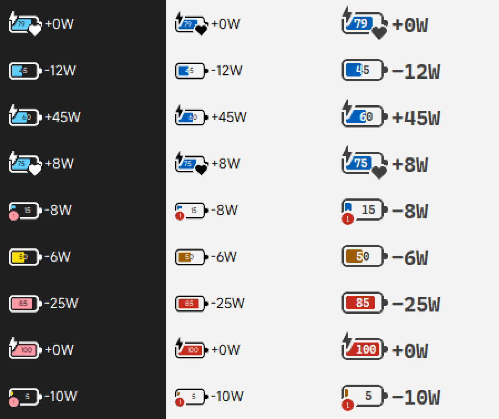

# TrafficMonitor-BatteryCombo

[TrafficMonitor](https://github.com/zhongyang219/TrafficMonitor) 插件：在一个显示项目里同时显示**电池电量**和**电池实时功率**。电池图标直接使用 Windows 11 任务栏同款字形绘制，电量数字显示在电池内部。


## 功能

- **Windows 同款电池图标**：外壳、圆角、正极、充电闪电均取自系统图标字体 Segoe Fluent Icons（MobBattery 系列），只把中段横向拉长以放下电量数字，抗锯齿和系统托盘一致。
- **电量数字在电池内部**：按数字墨迹居中，落在填充色上的部分自动换成反差色。
- **实时功率**：整数瓦，充电显示 `+`，放电显示 `-`；接通电源时 0 瓦显示为 `+0W`。
- **按电源模式着色**：最佳能效 → 黄色，平衡 → 蓝色，最佳性能 → 红色（同时识别「节能 / 高性能 / 卓越性能」电源计划）。深色、浅色任务栏各有一套配色。
- **角标**（与 Windows 托盘图标一致的镂空嵌入）：
  - 接通电源 → 左上角闪电
  - 电量 ≤ 20% 且未接通电源 → 左下角感叹号
  - Windows 电池养护（充电受限）→ 右下角爱心
- **布局跟随 TrafficMonitor**：电池像标签一样靠左；开启「数值右对齐」时功率贴右边缘，关闭时紧跟在电池后面。
- 鼠标悬停提示：电量、状态、功率、电源模式、剩余时间。



## 安装

1. 从 [Releases](https://github.com/CharlesGool/TrafficMonitor-BatteryCombo/releases) 下载 `BatteryCombo.dll`。
2. 放到 TrafficMonitor 目录下的 `plugins` 文件夹，重启 TrafficMonitor。
3. 右键 TrafficMonitor →「显示设置」，勾选「电池电量与功耗」。

要求：Windows 10/11（Windows 10 使用 Segoe MDL2 Assets 字形）、64 位 TrafficMonitor。

## 编译

使用 [Zig](https://ziglang.org/) 自带的 clang 交叉编译，无需安装 Visual Studio：

```bat
python -m pip install ziglang
build.bat
```

也可以用 MSVC 或 MinGW 编译，链接 `setupapi`、`gdi32`、`user32` 即可。

## 实现说明

- **功率**：通过 `IOCTL_BATTERY_QUERY_STATUS` 读取电池驱动上报的 `Rate`（mW），多块电池时求和。
- **电池养护**：官方文档没有对应的标志位。实测电池养护生效时 `BATTERY_STATUS.PowerState` 会带上未公开的 `0x10`，对应 ACPI 6.4 `_BST` 的 "Battery Charge Limiting" 位；拔掉电源后该位可能保持置位，因此只在接通电源时显示爱心。依赖固件按 ACPI 规范上报，部分机型可能无法识别。
- **电源模式**：`PowerGetActiveScheme` 读取电源计划，`PowerGetEffectiveOverlayScheme` 读取电源模式滑块。
- **插件接口**：`PluginInterface.h` 是按 TrafficMonitor 插件接口重新声明的 ABI 兼容头文件，插件报告 API 版本 7。
- 定义 `BATTERY_COMBO_TEST` 编译时会额外导出 `TestSetState`，用于模拟各种电池状态做渲染预览。

## 许可

[MIT](LICENSE)
